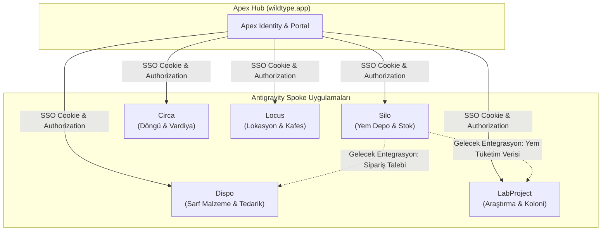
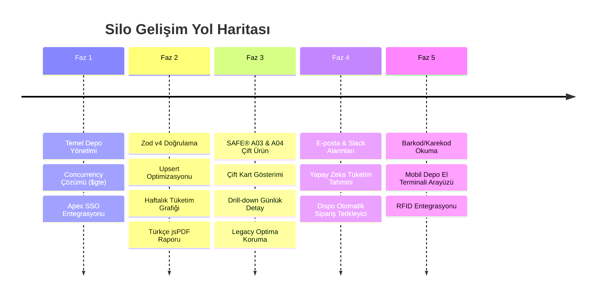

# Silo - Ürün Vizyonu ve Mimari Tasarım Belgesi (BLUEPRINT)

Bu belge, **Silo** envanter yönetim sisteminin ürün vizyonunu, felsefesini, domain kurallarını, ekosistem entegrasyonunu ve fazlandırılmış gelişim yol haritasını ortaya koyar.

---

## 🌟 Ürün Vizyonu ve Felsefesi

**Silo**, adını endüstriyel tarım ve hammadde depolamasında kullanılan devasa, sarsılmaz tahıl ambarlarından alır. Laboratuvar ortamlarında deneysel araştırmaların kesintiye uğramadan devam edebilmesi için en temel yaşam kaynağı olan kemirgen yemlerinin eksiksiz ve hatasız yönetilmesini sağlar.

Sistem, **"Endüstriyel Güvenilirlik" (Industrial Reliability)** felsefesi üzerine inşa edilmiştir:
1. **Sıfır Hata Payı:** Canlı hayvan deneylerinde yemin tükenmesi veya yanlış yem türünün verilmesi telafisi imkansız bilimsel kayıplara yol açar. Silo, kritik eşikleri dinamik olarak takip eder ve stok eksiye düşüşünü motor düzeyinde engeller.
2. **Kayıpsız Şeffaflık:** Her bir paket hareketi kimin, ne zaman ve hangi yem üzerinde işlem yaptığı bilgisiyle silinemez şekilde mühürlenir.
3. **Maksimum Hız, Minimum Sürtünme:** Laboratuvar personeli eldivenli ve hareket halinde çalışırken arayüz karmaşasıyla vakit kaybetmemelidir. Eylemler 2 tıklama ile tamamlanacak sadelikte tasarlanmıştır.

---

## 🎯 Hedef Kitle ve Kullanım Senaryoları

- **Laboratuvar Hayvanları Bakım Personeli:** Günlük kafes yemleme turlarında tükenen yemlerin depodan çıkışını saniyeler içinde kaydeder.
- **Tesis Yöneticileri ve Lojistik Sorumluları:** Haftalık ve aylık yem sarfiyatını izler, yaklaşan tedarik ihtiyaçlarını tespit eder ve kurumsal A4 PDF raporu alarak fatura/irsaliye mutabakatı yapar.
- **Baş Araştırmacılar (PI) ve Denetçiler:** Deney gruplarının (üreme dönemi vs. yetişkinlik dönemi) tükettiği yem miktarlarını geçmişe dönük denetim kayıtlarından doğrular.

---

## 🧩 Ekosistem Mimarisi (WildType & Antigravity)

Silo tek başına yalıtılmış bir silo değil, **Antigravity** ekosisteminin aktif bir üyesidir:

- **Apex SSO Entegrasyonu:** Kullanıcı kimlikleri, oturum güvenliği ve uygulama yetki listesi Apex üzerinden tek noktadan yürütülür.
- **Dispo Entegrasyonu (Gelecek):** Silo'da kritik stok eşiği aşıldığında tedarik uygulaması olan Dispo'ya otomatik satın alma siparişi gönderilecektir.

---

## 📐 Domain Kuralları ve İş Mantığı

1. **Ürün Standardizasyonu:**
   - **SAFE® A03:** Yalnızca damızlık, üreme ve büyüme süreçlerindeki kemirgenler için kullanılır. Sabit ambalaj ağırlığı **10 kg**'dır.
   - **SAFE® A04:** Yetişkin hayvanların rutin beslenmesi ve idame süreçleri içindir. Sabit ambalaj ağırlığı **10 kg**'dır.
   - **Optima 4kg:** Arşiv verisidir; yeni giriş/çıkış yapılamaz, ancak geçmiş raporlarda ağırlığı **4 kg** olarak hesaplanır.
2. **Kritik Eşik Seviyesi (Low Stock Threshold):**
   - Her yem türü için kritik eşik **`10 Paket`** (`100 kg`) olarak sabitlenmiştir.
   - `totalStock <= 10` olduğunda sistem **"Stok Az"** uyarısı verir. Bu eşik, tipik bir laboratuvarın tedarik süresi (2 hafta) göz önüne alınarak belirlenmiştir.
3. **Atomik Bakiye Kuralı:**
   - Depo stoğu hiçbir koşulda negatif (`< 0`) olamaz. Eşzamanlı çıkışlarda veritabanı düzeyinde filtreleme zorunludur.
4. **Zaman Dilimi Bütünlüğü:**
   - Haftalık ve günlük tüketim raporları daima `Europe/Istanbul` saat dilimine ve Pazartesi-Pazar döngüsüne göre hesaplanır.

---

## 🗺️ Yol Haritası ve Faz Planı

---

### Faz 1: Temel Depo Yönetimi ve Concurrency (Tamamlandı ✅)
- [x] Gerçek zamanlı stok takibi ve silinemez `transactions` koleksiyonu.
- [x] Basit Stok Giriş (`IN`) ve Stok Çıkış (`OUT`) aksiyonları.
- [x] **Yarış Durumu Önleme:** MongoDB atomik `$gte` filtresi ile çakışan çıkış isteklerinde eksiye düşmenin engellenmesi.
- [x] Apex merkezi kimlik denetimi (`interapp_session` cookie) doğrulaması.

### Faz 2: Standardizasyon, Analitik ve Raporlama (Tamamlandı ✅)
- [x] **React Router v7:** Tek sayfa yönlendirme altyapısı.
- [x] **Zod v4:** Sunucu katmanında tam tip ve girdi doğrulaması.
- [x] **Upsert Optimizasyonu:** `IN` işlemlerinde ekstra `findOne` sorgusunun kaldırılarak tek adımda `{ upsert: true }` ile güncellenmesi.
- [x] **Haftalık Tüketim Analitiği:** 7 haftalık geriye dönük tüketim sütun grafiği.
- [x] **Türkçe Karakter Destekli PDF:** Tinos TTF fontları çalışma zamanında VFS'e gömülerek `jsPDF` ile vektörel A4 rapor çıktısı.

### Faz 3: Çoklu Yem Standardizasyonu — SAFE® A03 & SAFE® A04 (Tamamlandı ✅)
- [x] **Çift Yem Ayrımı:** SAFE® A03 (10 kg) ve SAFE® A04 (10 kg) için bağımsız metrik kartları ve veritabanı dokümanları (`inventory_stats`).
- [x] **Arşiv Uyumluluğu:** Eski 4 kg Optima kayıtlarının kayıpsız korunması ve dinamik `getProductInfo()` desteği.
- [x] **Native `<dialog>` Deneyimi:** Klavye odaklanması, `closedby="any"` light-dismiss ve erişilebilirlik (a11y) geliştirmeleri.
- [x] **Drill-Down Grafik Görünümü:** Tıklanan haftanın 7 gününe ait günlük tüketim dökümünün anında açılması.
- [x] **Filtreli Yığın (Stacked) Gösterim:** Grafikte `Tümü | SAFE® A03 | SAFE® A04` filtreleri ve ürün renk katmanları.

---

### Faz 4: Akıllı Depo, Öngörü ve Otomasyon (Planlanıyor 🚀)
- [ ] **Kritik Eşik Alarmları:** Stok 10 paketin altına indiğinde yetkili personele e-posta ve Webhook (Slack/Discord/Teams) bildirimleri gönderimi.
- [ ] **Tüketim Hızı ve Ömür Tahmini:** Geçmiş 8 haftalık tüketim ivmesine dayalı olarak mevcut yem stoğunun kaç gün yeteceğini hesaplayan regresyon algoritması.
- [ ] **Dispo Spoke Entegrasyonu:** Kritik seviyeye inen yem için doğrudan Dispo tedarik modülüne otomatik satın alma taslağı aktarımı.
- [ ] **Mevsimsel Sarfiyat Analitiği:** Yılın dönemlerine göre (üreme sezonları vb.) yem tüketim dalgalanmalarını öngören grafik analitiği.

---

### Faz 5: Donanım & IoT Entegrasyonu (Gelecek Vizyonu 🔭)
- [ ] **Karekod / Barkod Okuma:** Mobil cihaz kamerası veya el terminali ile çuval üzerindeki parti/lot numarasını okutarak anında teslimat alma.
- [ ] **Akıllı Depo Kantarları:** Silo tartım platformları ile otomatik kilo düşümü ve insan müdahalesiz stok mutabakatı.
- [ ] **RFID Etiket Takibi:** Depo kapısından geçen çuvalların otomatik olarak `transactions` günlüğüne yazılması.
