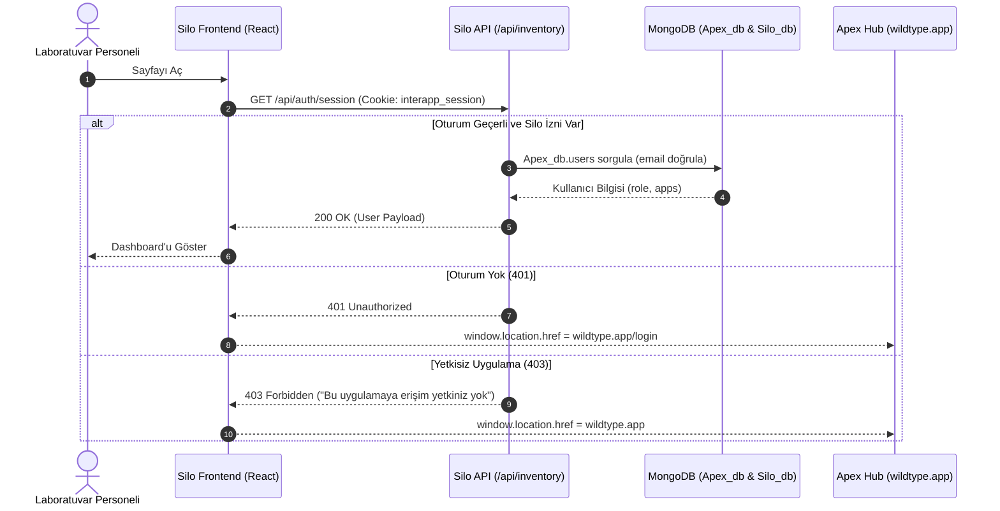

# Silo - Kemirgen Yemi Envanter ve Stok Yönetim Sistemi

[](https://react.dev/)
[](https://reactrouter.com/)
[](https://vite.dev/)
[](https://tailwindcss.com/)
[](https://zod.dev/)
[](https://www.mongodb.com/)
[](https://github.com/parallax/jsPDF)

**Silo**, Antigravity ekosisteminin (WildType Hub & Spoke mimarisi) temel depolama ve lojistik bileşenidir. Deneysel tıp ve laboratuvar kemirgen araştırmalarında kullanılan standart yemlerin (**SAFE® A03** ve **SAFE® A04**) stok döngüsünü, tüketim hızını ve tedarik hareketlerini miligram ve paket hassasiyetinde takip eden yüksek güvenilirlikli bir envanter yönetim platformudur.

Sistem, fiziksel depo ile dijital kayıtlar arasında **"Tek Doğruluk Kaynağı" (Single Source of Truth)** vazifesi görür. Çakışan eşzamanlı işlemlerde (concurrency) stokların eksiye düşmesini engelleyen atomik veritabanı filtreleri, tek adımda güncelleyen upsert optimizasyonları, interaktif haftalık/günlük tüketim grafikleri ve Türkçe karakter destekli A4 PDF tüketim raporlaması sunar.

---

## 🌟 Temel Özellikler

### 1. Çoklu Yem Takibi ve Çift Kart Mimarisi (SAFE® A03 & SAFE® A04)
- **SAFE® A03 (Üreme & Büyüme / Breeding):** 10 kg/paket standardında üretilen damızlık ve büyüme dönemi yeminin anlık paket adedi ve toplam kilogram hesabı.
- **SAFE® A04 (Bakım & İdame / Maintenance):** 10 kg/paket standardında yetişkin kemirgen rutin bakım yeminin anlık paket ve ağırlık takibi.
- **Kritik Eşik Uyarı Sistemi:** Her iki yem için de `totalStock <= 10` paket (`<= 100 kg`) seviyesi **"Stok Az"** (kehribar rengi uyarı); üzerindeki seviyeler ise **"Optimal Seviye"** (yeşil rozet) olarak gerçek zamanlı görselleştirilir.
- **Geriye Dönük Uyumluluk (Legacy Optima):** Sistemin geçmişinde kullanılmış olan 4 kg'lık **Optima** kayıtları silinmeden, geçmiş hareketlerde, agregasyon hesaplarında ve PDF raporlarında etiketlenerek bütünlük korunur.

### 2. Atomik Stok Yönetimi ve Veri Bütünlüğü
- **Eşzamanlılık (Race Condition) Koruması:** Paket çıkışlarında (`OUT`) MongoDB üzerinde atomik `{ _id: product, totalStock: { $gte: amount } }` koşulu çalıştırılır. Birden fazla personelin aynı anda çıkış yapması durumunda stok hiçbir koşulda negatif değere düşmez.
- **Upsert Optimizasyonu:** Teslimat alma (`IN`) işlemlerinde ekstra doküman varlık kontrolü yapılmadan tek adımda `{ upsert: true }` ve `$inc` operatörleriyle stok artırılır.
- **Zod v4 Tip Doğrulaması:** İstemciden gelen her işlem gövdesi sunucu katmanında Zod şemasıyla tip, işaret ve değer sınırları açısından sıkı kontrolden geçer.

### 3. Analitik Görselleştirme ve Drill-Down Tüketim Grafiği
- **7 Haftalık Periyot Gezintisi:** `Europe/Istanbul` saat dilimi ve ISO hafta standartlarına göre hesaplanan 7 haftalık dinamik bar grafiği.
- **Ürün Kırılımlı Yığın (Stacked) Gösterim:** Haftalık ve günlük barlarda mavi (A03), mor (A04) ve gri (eski Optima) oranları görsel olarak katmanlanır.
- **Drill-Down (Günlük Detay):** Herhangi bir haftaya tıklandığında veya klavyeden odaklanıp Enter basıldığında, o haftanın 7 gününe ait günlük tüketim kırılımı açılır.
- **Filtre Desteği:** Tek tıkla `Tümü | SAFE® A03 | SAFE® A04` görünümleri arasında geçiş yapılabilir.

### 4. VFS Gömülü Türkçe Karakter Destekli PDF Raporlama
- `jsPDF` ve `jspdf-autotable` kütüphaneleri kullanılarak istemci tarafında anında derlenen kurumsal A4 dökümü.
- Türkçe karakterler (ğ, ü, ş, ı, ö, ç) ve tescilli marka sembolünün (`®`) kusursuz görüntülenmesi için `/public/Tinos-Regular.ttf` ve `/public/Tinos-Bold.ttf` fontları çalışma anında VFS (Virtual File System) içerisine ArrayBuffer üzerinden Base64 formatında enjekte edilir.
- Mevcut A03 / A04 stok durum kartları, toplam geçmiş tüketim özeti ve haftalık ürün detay tablosunu içerir.

### 5. Apex SSO ve Merkezi Güvenlik
- Antigravity ekosisteminin merkezi kimlik yöneticisi olan **Apex** (`wildtype.app` / `Apex_db`) ile paylaşılan `interapp_session` (veya test ortamında `interapp_session_test`) çerezi.
- HMAC-SHA256 algoritması ve zamanlama saldırılarına dayanıklı `crypto.timingSafeEqual` doğrulaması.
- Uygulama bazlı erişim denetimi (`user.apps.includes('silo')` veya `role: 'admin'`). Yetkisiz erişimlerde `401` veya `403` ayrımı yapılarak Apex login ekranına güvenli yönlendirme.

---

## 🛠️ Teknoloji Yığını

| Katman | Teknoloji | Versiyon | Kullanım Amacı |
| :--- | :--- | :--- | :--- |
| **Frontend Framework** | [React](https://react.dev/) | `^19.2.0` | Deklaratif kullanıcı arayüzü ve modern hook mimarisi |
| **Routing** | [React Router DOM](https://reactrouter.com/) | `^7.16.0` | İstemci tarafı sayfa yönlendirmesi (`BrowserRouter`, `Routes`) |
| **Build & Dev Tool** | [Vite](https://vite.dev/) | `^7.2.4` | Yüksek hızlı HMR ve Vercel Serverless yerel simülasyonu |
| **Styling** | [Tailwind CSS](https://tailwindcss.com/) | `^3.4.17` | Responsive, endüstriyel arayüz tasarımı ve tipografi |
| **İkonografi** | [Lucide React](https://lucide.dev/) | `^0.563.0` | Depo ve stok operasyon ikonları (`Package`, `Weight`, `LogOut` vb.) |
| **PDF Motoru** | [jsPDF](https://github.com/parallax/jsPDF) | `^4.2.1` | İstemci tarafı dinamik PDF belgesi derleme |
| **PDF Tablo Eklentisi** | [jspdf-autotable](https://github.com/simonbengtsson/jsPDF-AutoTable) | `^5.0.8` | Sayfalandırmalı, renkli ve ızgaralı veri tabloları |
| **Veri Şeması Doğrulama** | [Zod](https://zod.dev/) | `^4.4.3` | Backend API istek gövdesi doğrulama |
| **Veritabanı Sürücüsü** | [MongoDB Node.js Driver](https://www.mongodb.com/) | `^7.0.0` | Bağlantı havuzlama (`MongoClient`), atomik sorgular |
| **Backend Runtime** | Vercel Serverless Functions | Node.js ESM | Sunucusuz API uç noktaları (`/api/*`) |
| **Çevresel Değişkenler** | [dotenv](https://www.npmjs.com/package/dotenv) | `^17.2.3` | Yerel geliştirme ortamında `.env` yönetimi |

---

## 📦 Kurulum ve Çalıştırma

### Gereksinimler
- **Node.js:** v20.19+ veya v22.12+ (LTS önerilir)
- **Paket Yöneticisi:** `npm` (v10+)
- **MongoDB:** Atlas veya yerel MongoDB instance'ı

### 1. Depoyu Klonlama ve Bağımlılıkları Yükleme
```bash
git clone https://github.com/ogzhnbygl/Silo.git
cd Silo
npm install
```

### 2. Ortam Değişkenleri (.env) Yapılandırması
Kök dizinde bir `.env` dosyası oluşturun ve aşağıdaki değişkenleri tanımlayın:

```env
# MongoDB Bağlantı Adresi (Atlas veya Yerel)
MONGODB_URI=mongodb+srv://<kullanici>:<sifre>@cluster.mongodb.net/?retryWrites=true&w=majority

# Apex SSO ile Paylaşılan Ortak JWT İmzası
JWT_SECRET=super_secret_jwt_key_wildtype_ecosystem

# İsteğe Bağlı: Test Ortamında Prod Veritabanını Zorlamak İçin
# FORCE_PROD_DB=false
```

### 3. Geliştirme Sunucusunu Başlatma
```bash
npm run dev
```

> [!NOTE]
> `vite.config.js` dosyası içerisinde yer alan `vercelServerless()` özel Vite eklentisi sayesinde harici bir Vercel CLI aracına gerek kalmadan `/api/*` uç noktaları `localhost:5173` üzerinde tam işlevli olarak çalışır. Geliştirici modu (`import.meta.env.DEV`), `src/main.jsx` içerisindeki fetch interceptor ile otomatik olarak `dev@wildtype.app` kimliğini taklit eder.

### 4. Üretim Derlemesi (Build & Preview)
```bash
# Kod denetimi
npm run lint

# Statik ve sunucusuz üretim paketi derleme
npm run build

# Üretim paketini yerel olarak önizleme
npm run preview
```

---

## 📂 Proje Dizin Yapısı

```text
Silo/
├── api/                            # Vercel Serverless Backend API'leri
│   ├── auth/
│   │   └── session.js              # Kullanıcı oturum doğrulama ve çıkış (GET, POST, DELETE)
│   ├── lib/
│   │   └── auth.js                 # Silo uygulamasına özgü yetkilendirme sarmalayıcısı
│   └── inventory.js                # Envanter CRUD, agregasyon ve atomik stok kontrolü
├── lib/                            # İstemci & Sunucu Ortak Modülleri
│   ├── auth.js                     # HMAC-SHA256 doğrulama ve Apex_db erişim kontrolü
│   ├── mongodb.js                  # Global singleton MongoClient havuzu ve veritabanı çözümleyici
│   └── products.js                 # SAFE® A03, A04 ve legacy OPTIMA ürün metadata kataloğu
├── public/                         # Statik Dosyalar
│   ├── Tinos-Bold.ttf              # PDF için gömülü Türkçe kalın font
│   ├── Tinos-Regular.ttf           # PDF için gömülü Türkçe normal font
│   └── favicon.ico                 # Uygulama simgesi
├── src/                            # React 19 Frontend Kaynak Kodları
│   ├── assets/                     # İkon ve görseller
│   ├── components/                 # Modüler Arayüz Bileşenleri
│   │   ├── ActionCard.jsx          # "Teslimat Al" ve "Paket Çıkışı" hızlı eylem butonları
│   │   ├── ActivityList.jsx        # Son depo hareketleri listesi ve "Tümünü Gör" görünümü
│   │   ├── ConsumptionChart.jsx    # Haftalık/günlük drill-down destekli sütun grafiği
│   │   ├── Dashboard.jsx           # Ana yönetim paneli (State koordinatörü)
│   │   ├── Layout.jsx              # Apex entegreli üst gezinme çubuğu ve ortam rozeti
│   │   ├── ProductStockCard.jsx    # SAFE A03 ve A04 bağımsız stok, kg ve kritik seviye kartı
│   │   └── TransactionModal.jsx    # Native <dialog> tabanlı, erişilebilir stok işlem modalı
│   ├── context/
│   │   └── AuthContext.jsx         # Oturum yönetimi, token kontrolü ve Apex SSO yönlendiricisi
│   ├── utils/
│   │   └── pdfGenerator.js         # jsPDF + autotable ile kurumsal A4 PDF raporlayıcı
│   ├── App.jsx                     # Ana yönlendirici şablonu (React Router v7)
│   ├── index.css                   # Tailwind CSS yönergeleri ve özel stiller
│   └── main.jsx                    # React kök montajı ve yerel dev interceptor
├── .env                            # Yerel ortam değişkenleri
├── eslint.config.js                # ESLint flat konfigürasyonu
├── index.html                      # HTML5 giriş şablonu
├── package.json                    # Bağımlılıklar ve komut dosyaları
├── postcss.config.js               # PostCSS konfigürasyonu
├── tailwind.config.js              # Tailwind tema ayarları
├── vercel.json                     # Vercel yönlendirme kuralları (SPA rewrites)
└── vite.config.js                  # Vite konfigürasyonu ve yerel Serverless emülatörü
```

---

## 🔐 Güvenlik ve Yetkilendirme Modeli

Silo, bağımsız bir kullanıcı veritabanı tutmaz. WildType Hub & Spoke mimarisinin bir parçası olarak kimlik doğrulama süreçleri **Apex** üzerinden yürütülür:



- **interapp_session:** Kullanıcı oturum açtığında `.wildtype.app` kök etki alanına yazılan `HttpOnly`, `SameSite=Lax`, `Secure` JWT çerezidir.
- **apps Dizisi:** Kullanıcının `Apex_db.users` kaydındaki `apps` listesinde `"silo"` bulunmalı veya kullanıcının rolü `"admin"` olmalıdır.

---

## 📚 Dokümantasyon Rehberi

Daha derin teknik analiz ve mimari detaylar için aşağıdaki dokümanları inceleyebilirsiniz:

- **[TECHNICAL.md](./TECHNICAL.md):** Tam veritabanı şeması, koleksiyon yapıları, API uç noktası istek/yanıt referansları, atomik işlemler, concurrency çözümleri ve saat dilimi algoritmaları.
- **[BLUEPRINT.md](./BLUEPRINT.md):** Ürün felsefesi, domain kuralları, endüstriyel güvenilirlik ilkeleri, tamamlanan fazlar ve gelecek otomasyon yol haritası.

---

## 📄 Lisans

Bu yazılım ve tüm Antigravity ekosistem bileşenleri özel mülkiyettir. Tüm hakları saklıdır. İzinsiz kopyalanamaz, çoğaltılamaz ve dağıtılamaz.
